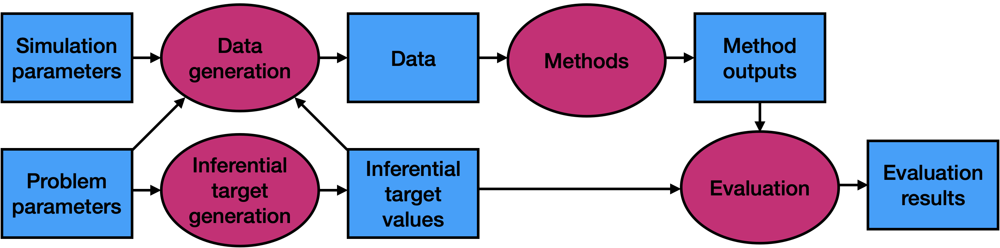

<!-- README.md is generated from README.Rmd. Please edit that file -->

# `simulatr`: Pipeline-first simulation studies in R

<!-- badges: start -->
[](https://github.com/Katsevich-Lab/simulatr/actions/workflows/R-CMD-check.yaml)
[](https://app.codecov.io/gh/Katsevich-Lab/simulatr)
[](https://katsevich-lab.github.io/simulatr/)
<!-- badges: end -->



`simulatr` is an R package for designing simulation studies that are
portable from laptop to cluster without rewriting any of the simulation
code. A study is built from four typed components — `simulatr_model()`,
`simulatr_method()`, `simulatr_metric()`, and the `simulatr_study()`
they plug into — and realized with three verbs: `simulatr_generate()`,
`simulatr_run()`, `simulatr_evaluate()`. Constructors validate every
function's argument names against the parameter grid at build time, so a
typo in a method's signature fails on the laptop, not after eight hours
on the cluster. A laptop-only `simulatr_check(study, B = 2)` runs the
full pipeline in-memory for debugging.

For production scale, the companion
[`simulatr-pipeline`](https://github.com/Katsevich-Lab/simulatr-pipeline)
Nextflow workflow consumes a saved `simulatr_study`, automatically
benchmarks per-grid-row memory and runtime, shards work across
Slurm/LSF/cloud, and writes one result `.parquet` per
`(method, grid_row, chunk)` plus a `memory.parquet` collected from the
kernel's view of resident set size. The package and pipeline are joined
by an explicit on-disk contract shipped with the package at
`inst/extdata/contract.json` and asserted by the pipeline at workflow
start, so the two can be versioned independently.

## Installation

You can install the development version from
[GitHub](https://github.com/) with:

```
# install.packages("remotes")
remotes::install_github("Katsevich-Lab/simulatr")
```

A pre-built container image (`ghcr.io/katsevich-lab/simulatr:<version>`)
is published on every release.

## Documentation

* `vignette("getting-started", package = "simulatr")` — ten-minute
  laptop walk-through using `simulatr_check()`.
* `vignette("writing-a-method", package = "simulatr")` — typed
  constructors, batched generation, the RNG protocol.
* `vignette("running-on-a-cluster", package = "simulatr")` — install
  and run the Nextflow pipeline on Slurm.
* `vignette("reproducibility-and-seeding", package = "simulatr")` —
  `simulatr_session_info()`, container, `renv.lock`.
* `vignette("reading-your-memory-profile", package = "simulatr")` —
  Layer-1 vs Layer-2 memory numbers, what large deltas mean.

The full reference site lives at
<https://katsevich-lab.github.io/simulatr/>.

## Acknowledgment

We thank Jacob Bien for developing the
[`simulator` package](https://jacobbien.github.io/simulator/), whose
typed component vocabulary inspired the redesign of `simulatr`. Tim
Barry led the original implementation of `simulatr`; this 1.0 redesign
builds on that foundation. `simulatr` differs from `simulator` in being
*pipeline-first*: the workflow runner, not the R session, owns
parallelism, retries, and resumption.
